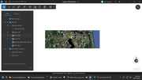

# CONTINUITY — EarthStick + Earth Beacon
**Date:** 2026-10-27  
**Purpose:** Preserve the exact current state, live-tested facts, published repositories, and the major new concepts developed around EarthStick, Earth Beacon, game-like GIS exploration, classroom use, and firefighter training.

---

## 1. CORE PROJECT STATE

### EarthStick 1.0 — FINISHED / LIVE-ACCEPTED
Repository: https://github.com/Jim-dc95811/EarthStick

EarthStick turns ArcGIS Earth into a directly piloted map using the Thrustmaster TCA Sidestick Airbus Edition.

Core public idea:

> **Fly the real map.**

EarthStick is not a conventional flight simulator. The actual ArcGIS Earth GIS/map becomes the world being flown.

### Accepted controls
- Stick X = strafe left/right
- Stick Y = forward/reverse
- Twist = heading
- Physical throttle = travel speed
- POV up/down = camera tilt
- Red top button = zoom in / descend
- Black thumb button = zoom out / climb
- Neutral controls = stop / hover

### Important behavioral fact
Neutral input is not merely “nothing happens.” It creates a useful operational state:

> **Stop. Hover. Think. Then move.**

This is one of the most important EarthStick advantages over keyboard/mouse or SpaceMouse control. The operator can stop completely, inspect the map, change layers, decide what to do next, and continue without fighting the camera.

### Operational insight
Keyboard/mouse or SpaceMouse control consumes attention maintaining camera attitude, horizon, heading, speed and position.

EarthStick reduces that camera-control workload enough that the operator can actually **observe the GIS while moving through it**.

EarthStick also makes the horizon view a practical working view rather than a temporary dramatic camera angle. The operator can cruise, stop, turn, inspect, resume, and remain spatially oriented.

---

## 2. EARTH BEACON 1.0 — FINISHED / LIVE-TESTED

Repository: https://github.com/Jim-dc95811/Earth-Beacon

Earth Beacon creates a tall vertical KML line at a geographic coordinate so the location remains visible from very long distances in an oblique ArcGIS Earth view.

Core public idea:

> **A pin marks a place. A beacon gives you something to aim at.**

Earth Beacon uses standard KML 3D geometry. The geometry itself is not claimed as a new invention. The unusual part is using the vertical line intentionally as a long-range visual navigation/homing marker inside ArcGIS Earth.

### Live-tested behavior
User created the beacon and tested it in ArcGIS Earth successfully.

Observed live behavior:
- Vertical beacon clearly visible against the horizon.
- Screenshot showed approximately 102 km eye altitude while the beacon remained plainly visible.
- User reports being able to see the beacon from extremely long regional distances, including from multiple states away in some views.
- When oriented essentially parallel to the ground at/near the beacon, the vertical line becomes effectively invisible.
- This is desirable behavior: obvious while approaching, unobtrusive when working close to the destination.
- Beacon layers can be toggled on/off in ArcGIS Earth.

### Beacon Maker v1.0
Coordinate input methods:
- Manual latitude / longitude
- Windows clipboard
- Current ArcGIS Earth camera position through Automation API

Clipboard handling supports:
- comma-separated coordinates
- whitespace-separated coordinates
- labeled latitude/longitude
- ambiguous coordinate pairs are flagged rather than silently treated as certain
- Swap Lat/Lon button

Default beacon:
- 100 km tall
- red
- line width 6
- `relativeToGround`
- KML output
- optional automatic open after creation

The v1.0 source/package was live-tested before the GitHub page was built.

### Name behavior
The Beacon Maker defaults the name field to `EarthStick Beacon`, but a user-entered name is used in the KML placemark/document. The default name is only used if the field is left blank.

---

## 3. EARTHSTICK + EARTH BEACON — THE IMPORTANT COMBINATION

Earth Beacon by itself is a clever geographic marker.

EarthStick gives it operational purpose.

The combination is:

> **EarthStick = movement**  
> **Earth Beacon = destination**  
> **GIS layers = meaning**

Or:

> **Drop a beacon anywhere on Earth, then fly the real map toward it.**

Before EarthStick, a horizon-visible KML pillar had limited practical value because ordinary ArcGIS Earth navigation requires too much camera manipulation.

With EarthStick, the operator can:
1. acquire the beacon visually
2. fly toward it
3. stop/hover anywhere
4. inspect the map
5. change layers
6. resume flight
7. arrive without losing orientation

This creates a simple visual navigation language inside ArcGIS Earth.

### “Where is home?” behavior
A particularly strong use case is:
1. fly into an area and become semi-lost
2. turn the home beacon layer on
3. rotate until the beacon appears on the horizon
4. point toward it
5. fly home
6. turn the beacon off again when no longer needed

No bearing calculation is required. The beacon acts like a visual geographic reference anchored to a real place.

Useful phrase:

> **EarthStick makes horizon flight practical. Earth Beacon makes horizon flight navigable.**

---

## 4. CURRENT HIGH-VALUE BEACON USES

### Fixed facilities
Possible district-wide persistent beacon layer for:
- offices
- fire stations
- yards
- dispatch locations
- training sites
- staging areas
- landing zones
- other fixed operational facilities

Concept name:

> **District Beacon Network**

This would allow an operator to answer visually:

> “Where is that facility from here?”

without calculating a bearing or searching a flat map.

### Incident / operational targets
Potential beacons for:
- incident locations
- staging
- ICP
- landing zones
- parcel / tract targets
- search sectors
- inspection points
- home base

### Feature-derived beacons
Any existing GIS point feature could theoretically generate a beacon.

Example discussed:
- fire hydrants

Potential encoding:
- blue = hydrant
- green = tested / available
- yellow = limited
- red = out of service
- height/color could encode attributes

Important design insight:
Do **not** display enormous beacons for every feature across a huge region at once. Use an AOI, incident radius, selected grid, filtered subset, or similar visibility logic to avoid visual spaghetti.

---

## 5. BEACON TOURS — “FOLLOW THE RAINBOW”

A sequence of differently colored beacons can become a visual route/tour without drawing a continuous route line.

Example concept:
- red
- orange
- yellow
- green
- cyan
- blue
- magenta

Operator simply flies from one visible beacon to the next.

Phrase:

> **Follow the rainbow.**

Potential uses:
- helicopter route familiarization
- district familiarization
- wildfire/disaster walkthroughs
- utility corridor inspections
- river/coastline tours
- historical tours
- forestry tracts
- scenic tours
- training routes
- presentations where the instructor wants the viewer to visit a series of specific locations

Possible future utility:

> **Earth Beacon Tour Maker**

Potential input:
- list of coordinates
- optional names
- automatic sequential colors
- one generated KML containing the complete tour

Not built yet.

---

## 6. MULTI-OPERATOR / COPILOT CONCEPT

EarthStick controls ArcGIS Earth through its Automation API.

Infrastructure insight:
If ArcGIS Earth instances/endpoints can be independently addressed, the same control stream could theoretically be sent to more than one Earth display or transferred between operators.

Possible roles:
- primary operator
- copilot / relief operator
- local expert
- instructor

### Port-pilot analogy
A local expert could temporarily take control of the map exactly like a harbor/port pilot takes temporary navigational responsibility aboard a ship.

They do not replace the main operator. They bring local knowledge for a specific geographic area.

Examples:
- district staff who know one county extremely well
- forester who knows a tract
- utility worker who knows a corridor
- fire officer who knows a response area
- emergency manager with local knowledge

They could say while actually flying the shared map:
- “That road washes out.”
- “That gate is usually locked.”
- “Come in from this side.”
- “That is our tract.”
- “That crossing is the one you want.”

Concept phrase:

> **Local pilotage for the map.**

No multi-user control software has been built yet.

---

## 7. MULTIPLE ARCGIS EARTH DISPLAYS — INFRASTRUCTURE IDEA

ArcGIS Earth Automation API uses a configurable base URL; the default is `http://localhost:8000`.

Theoretical architecture:

- Earth display 1 = imagery
- Earth display 2 = roads / labels
- Earth display 3 = parcels / operational GIS
- all displays receive the same camera state

This could create a multi-screen GIS cockpit where all views move together but each screen carries different layers.

Important status:
- Multiple networked computers/endpoints are conceptually straightforward.
- Multiple simultaneous ArcGIS Earth processes on one Windows machine using separate API ports has **not been live-tested**.
- Do not treat that specific same-PC behavior as proven.

---

## 8. CLASSROOM CONCEPT

One ArcGIS Earth instance appears on a shared classroom screen.

Each student has a joystick.

Only one joystick has control authority at a time.

Instructor selects the active pilot through a small GUI.

Basic control model:
- Student 1 — available
- Student 2 — available
- Student 3 — PILOT
- Student 4 — available
- Instructor takeover
- Stop / hover
- next pilot

Handoff sequence:

> **fly → release controls → hover → transfer authority → next student flies**

Because neutral input means stop/hover, EarthStick is unusually well suited for controlled handoffs.

### Educational value
Students would not feel like they were being taught GIS software.

They would feel like they were:

> **taking turns flying the world**

While doing so they learn:
- spatial orientation
- distance and scale
- terrain recognition
- landmarks
- roads
- jurisdictions
- layer interpretation
- map-to-world recognition
- route selection
- observation before movement

Possible classroom challenges:
- fly to the next beacon
- find the county line
- identify location with labels off
- follow a river
- find a facility using imagery only
- navigate a route by a sequence of beacons

Phrase:

> **One Earth. One classroom. Twenty pilots.**

No classroom selector GUI has been built yet.

---

## 9. CLASSROOM USB INFRASTRUCTURE CONCEPT

Silex Technology network USB/device-server products were discussed as a practical way to bring many student USB joysticks back to one central Windows computer.

Possible architecture:

Student joysticks  
→ network USB / Silex device servers  
→ central Windows PC  
→ Python joystick-selector GUI  
→ EarthStick control engine  
→ ArcGIS Earth  
→ classroom display/projector

Preferred software concept:
- Windows sees all joysticks
- Python enumerates them
- instructor chooses which joystick ID is currently listened to
- all non-selected joysticks are ignored
- USB connections do not need to be physically switched for every student handoff if all devices can remain available to Windows

Possible GUI:
- student name
- joystick/device status
- TAKE CONTROL
- ACTIVE PILOT
- INSTRUCTOR
- STOP/HOVER

This architecture is only conceptual. It has not been built or live-tested.

---

## 10. ROUTE FAMILIARIZATION / HELICOPTER USE

Important conceptual use:

An experienced helicopter pilot could use EarthStick to rehearse a route through real GIS/map imagery.

Useful sequence:
1. labels/borders/roads/operational layers ON
2. fly the intended route and learn names/features intellectually
3. switch to imagery only
4. fly the same route again
5. verify visual recognition without textual cues
6. optionally re-enable only mission-relevant overlays

This creates:

> **annotated pass → visual pass**

and a learn/remove-cues/verify-recognition loop.

Earth Beacon adds visible destinations and route legs to that process.

Do not turn this into unnecessary aviation disclaimer language when the user is discussing conceptual map familiarization rather than asking for real flight instructions.

---

## 11. “GTA OF MAPWORLD” CONCEPT

User description:

> **“It’s the GTA of mapworld.”**

Useful meaning behind the joke:
- free roaming
- stop anywhere
- choose destinations
- follow beacons
- switch labels/imagery
- turn GIS layers on/off
- inspect features
- continue moving

Difference from a game:
- the world is the real GIS/map
- the features and layers carry real operational meaning

Useful framing:

> **In a game, the world exists to support the game.  
> Here, the real map is the world.**

---

## 12. SCAVENGER-HUNT / GIS GAME CONCEPT — MAJOR NEW DIRECTION

The next major idea came from realizing that ArcGIS Earth already provides most of the pieces of a game engine once EarthStick supplies intuitive movement.

The key insight:

> **GeoJSON or other GIS point features can become Easter eggs, clues, objectives, and information pickups.**

A player can fly through the real map, recognize something interesting, stop/hover, click a feature, and discover information stored in the feature attributes.

Potential hidden feature types:
- point clues
- parcel polygons
- hydrants
- offices
- bridges
- airports
- landmarks
- buildings
- search zones
- boundaries
- special beacons

A clicked feature could contain:
- clue number
- question
- hint
- discovery message
- next objective
- point value
- trivia
- historical information
- instructions
- a photo reference
- optional coordinates for the next leg

Example clue concept:

> **CLUE #3**  
> Nice find.  
> Follow the river west until you reach the railroad bridge.  
> Your next target is somewhere within two miles.

The player then takes off again and continues the hunt.

### Core game mapping

A useful conceptual model is:

> **world = GIS**  
> **movement = EarthStick**  
> **navigation = Earth Beacon**  
> **objects = GeoJSON / GIS features**  
> **missions = attributes + layers**  
> **players = whoever has the joystick**

This led to the observation:

> **ArcGIS Earth already is the engine.**

The goal is not to write a traditional game engine. The goal is to use ArcGIS Earth, GIS data, EarthStick, and beacons to create interactive exploration.

---

## 13. SCAVENGER HUNT MAKER — SIMPLE AUTHORING TOOL CONCEPT

The hunt-builder should feel like filling out clue cards, **not doing GIS**.

### Coordinate input workflow
The easiest student/teacher coordinate workflow observed is Google Maps:
1. right-click a location
2. the latitude/longitude pair appears at the top of the context menu
3. click the coordinate pair
4. Google Maps copies it to the Windows clipboard
5. the Scavenger Hunt Maker reads the clipboard

No manual coordinate typing should be required for ordinary use.

### Proposed GUI
Possible controls:

- Hunt Name
- `ADD CLUE FROM CLIPBOARD`
- current latitude / longitude with validation
- clue number
- clue name
- icon picker
- color picker
- point value
- question
- hint
- discovery message
- next clue / next objective text
- `SAVE CLUE`
- `NEXT CLUE`
- clue count
- `CREATE SCAVENGER HUNT`

Example rough layout:

```text
SCAVENGER HUNT MAKER

Hunt Name:  Jacksonville Treasure Hunt

[ ADD CLUE FROM CLIPBOARD ]

Clue #4
Coordinates: 30.317887, -81.667561   ✓

Name:          River Mystery
Icon:          [ Treasure Chest ▼ ]
Color:         [ Yellow ▼ ]
Points:        100

Question:
What major river are you looking at?

Hint:
Look at the bridges and surrounding labels.

Discovery Message:
You found it! Now head toward the railroad bridge.

[ SAVE CLUE ]      [ NEXT CLUE ]

------------------------------------
4 clues created

[ CREATE SCAVENGER HUNT ]
```

### Possible fun icons
- treasure
- mystery / question mark
- fire
- hydrant / water
- building
- airport
- forest
- bridge
- bonus star
- finish flag

The exact icon system has not been chosen.

### Output format
GeoPackage and GeoJSON were both discussed.

Current thinking:
- **GeoJSON** is extremely simple to generate and inspect.
- **GeoPackage** has the attraction of keeping an entire hunt in a single portable GIS database file.
- A prototype should test both in ArcGIS Earth before choosing a permanent format.

No Scavenger Hunt Maker has been built yet.

---

## 14. SCAVENGER-HUNT GAMEPLAY / REVEAL IDEAS

Possible mechanics developed in discussion:

### Hidden GIS Easter eggs
Scatter clickable features around the map. They can be obvious, subtle, or nearly invisible depending on the exercise.

### Parcel clues
A particular parcel could contain a message, hint, or next objective in its attributes.

### Hydrant clues
One particular hydrant among many could hold the next clue.

### Landmark / building clues
Players may need to recognize a real object in imagery and click the correct GIS feature.

### Beacon checkpoints
A beacon can mark a major checkpoint or only appear after a clue is found.

### Final beacon
After the final clue:

> **Turn on the GOLD beacon and fly to the finish.**

### Search zones
Boundaries or polygons could define the area in which the next clue is hidden.

### Labels as an earned aid
Possible exercise:
- begin with labels off
- player attempts visual recognition
- later clue allows labels to be turned on

### Layer progression
Different layers could be enabled as the exercise progresses, creating a simple mission/reveal system without changing the foundation map.

### Scoring
Potential scoring fields:
- points per clue
- bonus points
- time
- optional penalties
- alternate correct answers

No scoring engine has been built. This remains conceptual.

---

## 15. CLASSROOM SCAVENGER-HUNT EXPERIENCE

The classroom idea becomes much stronger when combined with the scavenger hunt.

Possible instructor setup:
- one shared ArcGIS Earth screen
- many student joysticks
- one active joystick at a time
- a prepared hunt layer
- beacon checkpoints / final beacon

Example classroom moment:

> “There are ten hidden objects somewhere in this county. You have the aircraft.”

One student flies while the whole class watches.

Someone sees something interesting and calls out:

> “STOP! What’s that?”

The pilot releases the controls.

EarthStick stops and hovers.

The class clicks the object.

The clue appears.

Then the instructor transfers control to the next student.

This produces a shared learning environment rather than twenty students separately clicking around twenty independent maps.

The students learn spatial orientation, map reading, landmarks, distance, layer interpretation, and route choice while feeling like they are playing an exploration game.

---

## 16. AI-GENERATED HUNTS — LONGER-TERM IDEA

A major future possibility is using AI to make hunt authoring accessible to ordinary teachers or trainers.

Instead of manually creating every clue, a teacher could eventually describe the desired exercise in ordinary language, for example:

> “Make me a 30-minute scavenger hunt around our county for fifth graders. Ten stops. Mix geography, history, and map-reading. Don’t reveal the next location until they find the clue.”

The AI-assisted authoring tool could then help create:
- clue text
- sequence/order
- point attributes
- beacon checkpoints
- difficulty levels
- age-appropriate questions
- alternate versions for different classes
- layer/reveal logic

Important distinction:
AI should not invent factual local-history or infrastructure claims when accuracy matters. It should use supplied/verified data or clearly mark fictional training content.

The larger concept is:

> **AI making GIS programmable by ordinary language.**

The teacher should not need to learn QGIS, ArcGIS Pro, coordinate systems, or database schemas simply to create an educational map exercise.

---

## 17. ADULT VERSION — FIREFIGHTER INCIDENT TRAINING TOOL

The scavenger-hunt mechanism immediately suggested a much more serious adult version for first-responder training.

Instead of treasure or trivia, trainees receive a simulated dispatch and must build situational awareness from the real map and operational layers.

Possible opening information box:

> **Wildland/structure fire reported at this location. Estimated size: 12 acres. Wind from the southwest. One structure threatened.**

The trainee flies to the incident using EarthStick and then has to identify or choose the operational pieces that matter.

Potential objectives:
- correct access route
- alternate access route
- primary egress / escape route
- secondary egress
- hydrants / water sources
- candidate landing zones
- staging areas
- nearby structures
- parcel ownership
- road choke points
- road closures
- jurisdiction boundaries
- terrain / obstacles
- search or safety zones

The trainee can stop/hover, inspect GIS features, click parcels, examine hydrants, change layers, and continue.

This is not simply a quiz. The purpose is to force spatial decision-making inside the actual geography.

---

## 18. INCIDENT SCENARIO PROGRESSION

The firefighter training tool could progress in stages:

> **Dispatch → Recon → Choose access → Locate water → Select staging/LZ → Identify egress → Receive new incident update → Reassess**

### Hidden / triggered information updates
GIS points or polygons can act like scenario triggers.

Examples:

> **Recon update:** Fire has crossed the road to the east. Reevaluate your exit route.

> **Hydrant:** 8-inch main, available.

> **LZ candidate:** Open field. Check surrounding obstacles and access.

> **Road update:** Access route blocked by apparatus congestion. Select an alternate.

The exercise can reveal additional information only after the trainee reaches, selects, or correctly identifies a feature.

### Choice-based evaluation
Real incidents often have more than one defensible answer.

Therefore the trainer should not necessarily enforce one rigid “correct” route.

Better possibilities:
- score the reasoning
- compare choices after the exercise
- identify missed information
- allow multiple defensible solutions
- replay from the same dispatch and try again

### Reset / repetition
One of the strongest advantages is repeatability:

> **Reset. Try it again from the same dispatch.**

A live training ground does not need to be restaged every time.

---

## 19. WHY THE FIREFIGHTER TRAINER COULD BE CHEAP TO STAGE

The traditional objections to live scenario exercises often include:
- too many people to coordinate
- apparatus tied up
- travel time
- site permissions
- safety planning
- props / signage
- instructors positioned everywhere
- weather
- fuel
- overtime
- difficulty repeating the same scenario

A virtual GIS scenario removes or greatly reduces many of those costs.

A new scenario could be created by changing relatively small layers and attributes:
- incident starting location
- fire perimeter
- access points
- hydrants
- landing-zone candidates
- staging
- road closures
- ownership
- hidden updates
- scoring criteria

The underlying imagery and basemaps do not have to be rebuilt.

This led to a possible future product name:

> **GIS Incident Scenario Builder**

This would complement, not replace, hands-on field/fireground training. Its value would be frequent, inexpensive geographic familiarization and decision-making practice.

---

## 20. FOUNDATION MAPS VS CHANGEABLE OPERATIONAL LAYERS

A major architecture insight is to keep the expensive foundation maps stable and make almost everything else an independent overlay.

### Foundation / durable world
Examples:
- Bing street map
- Google/Esri imagery TPKX
- Z20 detail blocks
- terrain / topographic basemaps
- other trusted offline map packages

### Changeable layers
Examples:
- parcels
- hydrants
- office icons
- facility photos
- fire perimeters
- landing zones
- road closures
- training clues
- beacons
- ownership information
- incident points
- district boundaries

Core architectural phrase:

> **Foundation = stable geography**  
> **Layers = changing information**

If a hydrant database changes, replace the hydrant layer.

If an office gets a new photo, update the photo/facility layer.

If a fire perimeter changes, replace the perimeter layer.

Do **not** regenerate 25 Z20 blocks or rebuild a massive TPKX just because small operational information changed.

This separation is central to keeping the system practical.

---

## 21. FACILITY PHOTOS / STREET-LEVEL RECOGNITION LAYER

A simple still-photo layer may be more useful than a full Street View system for many operational facilities.

Possible facility point attributes:
- facility name
- street address
- phone
- office/station type
- hours
- notes
- photo
- entrance / gate information

EarthStick workflow:

> **see facility icon → stop/hover → click → street-level photo appears → recognize the building → continue flying**

### Agency-owned photos
Agency-owned still photos may be preferable to third-party street imagery because the agency controls:
- freshness
- permissions
- framing
- correct entrance
- operational relevance

Useful photos could include:
- front entrance
- apparatus entrance
- gate
- parking/access
- helipad/LZ
- fuel point
- confusing approach features

This becomes an **air-to-ground recognition layer**.

### Popup implementation
The exact best container has not been proven yet.

If direct image display from GeoJSON/GeoPackage popups is awkward in ArcGIS Earth, KML popup HTML with referenced images may be a practical alternative.

Do not choose a permanent implementation until live-tested.

---

## 22. EXTERNAL STREET-LEVEL IMAGERY NOTES

Ground-level imagery sources discussed:
- Google Street View APIs
- Mapillary
- KartaView
- agency-owned imagery

### Google Street View
Useful for on-demand views, but bulk/offline storage is restricted by Google’s terms. Do not design the offline system around bulk Street View downloading.

### Mapillary
Mapillary has broad crowdsourced coverage and is increasingly integrated into the ArcGIS ecosystem, but ArcGIS Earth does not currently provide the same oriented-imagery experience as ArcGIS Pro/Map Viewer/Scene Viewer.

Potential future use:
- Mapillary location points in Earth
- links or image references in popups
- external ground-level context when available

### Agency-owned imagery
For fixed state offices, stations, gates, access points and similar facilities, simple agency-owned JPEGs may be the cleanest and most durable solution.

---

## 23. MAPWORLDS / BASEMAP SWITCHING

EarthStick does not fly one visual world. It flies whatever ArcGIS Earth can display.

Possible mapworlds include:
- satellite imagery
- street maps
- hybrid maps
- terrain/topographic maps
- imagery with labels
- parcel/operational overlays
- offline TPKX worlds
- 3D scene layers / integrated meshes

Useful phrase:

> **Same Earth. Different mapworlds.**

The operator can change the visual language of the place without changing position, heading, altitude, or route.

---

## 24. 3D GIS / “DRAGONFLY” EXPLORATION

EarthStick was tested in the public Frankfurt Integrated Mesh scene.

User successfully flew through the 3D scene and described the experience as flying around Frankfurt “like a dragonfly.”

Observed behavior:
- free flight through/around towers
- camera can pass through buildings because the mesh does not enforce collision
- ability to hover, circle, climb, descend, and re-approach

The Frankfurt scene itself was somewhat disappointing visually and difficult to render quickly at speed, so it is not currently considered the strongest video showcase.

Important conceptual insight:

> **EarthStick doesn’t just fly maps. It flies 3D GIS worlds.**

The no-collision behavior can actually be useful for unrestricted inspection because EarthStick is not trying to simulate aircraft physics.

---

## 25. VIDEO / PUBLIC DEMO DIRECTION

Current strong hook:

> **ArcGIS Earth Flight Simulator Is Far Better Than Google Earth!**

The target audience should not be only GIS professionals. There is a large existing audience around Google Earth flight/exploration videos.

The demo can bridge two communities:
- gamers / virtual-world explorers
- GIS / mapping users

Useful framing:

> **game-like control over a real GIS world**

Possible demo arc:
1. briefly show conventional Google Earth flight
2. cut to EarthStick in ArcGIS Earth
3. demonstrate horizon cruise
4. stop/hover
5. inspect a parcel / ownership
6. toggle labels/basemaps/operational layers
7. get semi-lost
8. ask “Which way is home?”
9. turn the home beacon on
10. rotate until it appears on the horizon
11. fly home
12. optionally show a quick 3D scene clip

The strongest demo is likely real imagery + operational layers + beacon navigation, not the Frankfurt mesh.

---

## 26. IMPORTANT PRESENTATION / PHILOSOPHY

EarthStick should not be described merely as a joystick hack.

Its deeper value is:

> **continuous map observation under direct analog control**

The operator can actually study the map while moving through it.

Earth Beacon should not be described merely as a vertical KML line.

Its deeper value is:

> **turning a geographic coordinate into a long-range visual destination**

The scavenger-hunt / training concept should not be described as “turning GIS into a toy.”

Its deeper value is:

> **using real GIS geography as an interactive world for exploration, learning and decision-making.**

Together, these tools create an environment where the map can be flown, interrogated, navigated, and used as the setting for exercises.

---

## 27. VERIFIED VS NOT YET VERIFIED

### VERIFIED
- EarthStick 1.0 live-tested and accepted.
- Neutral controls stop/hover.
- EarthStick provides clean direct map flight in ArcGIS Earth.
- EarthStick supports practical horizon-view flying.
- Earth Beacon v1.0 creates a working vertical KML beacon.
- Beacon visible from very long range.
- User observed beacon becomes effectively invisible when viewed parallel to the ground.
- Beacon layer can be toggled on/off in ArcGIS Earth.
- Clipboard coordinate import works in Beacon Maker.
- ArcGIS Earth camera coordinate import exists in Beacon Maker.
- User has used EarthStick to stop and interrogate parcel ownership in ArcGIS Earth.
- User has used EarthStick to approach airports/runways and perform map-level “landings”/departures.
- EarthStick was used successfully in the Frankfurt integrated-mesh 3D scene.
- Earth Beacon repository published.
- EarthStick repository published.

### CONCEPTUAL / NOT BUILT
- Beacon Tour Maker
- district bulk beacon generator
- automatic GIS feature → beacon conversion
- hydrant beacon generator
- beacon filtering by AOI/radius
- multi-operator EarthStick
- copilot control handoff
- classroom joystick selector
- Silex classroom joystick network
- synchronized multiple ArcGIS Earth displays
- multiple ArcGIS Earth instances on same PC using different API ports
- Scavenger Hunt Maker
- GeoPackage/GeoJSON hunt-builder GUI
- AI-authored hunt generator
- clue sequencing / reveal engine
- scoring engine
- final-beacon game progression
- answer-triggered beacon reveal/controller
- automated scenario-state → KML beacon show/load logic
- firefighter GIS Incident Scenario Builder
- triggered incident updates
- scenario scoring/evaluation framework
- facility-photo popup layer
- Mapillary/KartaView integration inside Earth

Do not accidentally present these conceptual items as finished products.

---

## 28. CURRENT REPOSITORIES

### EarthStick
https://github.com/Jim-dc95811/EarthStick

### Earth Beacon
https://github.com/Jim-dc95811/Earth-Beacon

Related broader mapping ecosystem may include Parcel100, MBTiles→TPKX, offline ArcGIS Earth map generation and other tools, but those were not modified as part of this continuity update.

---

## 29. NEXT-SESSION STARTING POINT

When resuming, do not reinvent EarthStick or Earth Beacon.

Both current v1.0 products are accepted.

The most fertile next directions are now:

1. **Scavenger Hunt Maker** — clipboard coordinate → clue card → progressive beacon reveal → GeoJSON/GeoPackage
2. **Firefighter GIS Incident Scenario Builder**
3. **Earth Beacon Tour Maker / Follow the Rainbow**
4. **bulk beacons from GIS point datasets**
5. **district facility beacon network**
6. **hydrant beacons with controlled visibility**
7. **facility-photo recognition layer**
8. **classroom joystick-selector architecture**
9. **copilot/local-pilot control handoff**
10. **multi-screen synchronized ArcGIS Earth views**

Before building anything, preserve the Minimal Build Rule:
- implement only the requested function
- do not refactor accepted tools without approval
- preserve working filenames/paths/behavior
- make new versions for functional code changes
- do not call a version accepted until it is live-tested in ArcGIS Earth

---

## 30. CURRENT ONE-LINE SUMMARY

> **EarthStick lets you fly the real map. Earth Beacon gives you something to fly toward. GIS layers can now turn that world into an interactive game, classroom, or incident-training environment.**

---

## 31. ANSWER-TRIGGERED BEACONS — PROGRESSIVE REVEAL MECHANIC

A major progression idea is to make beacons appear only after the player or trainee successfully completes the current objective.

Core loop:

> **find clue → stop/hover → click/inspect → answer or make a decision → correct/acceptable response → next beacon appears → fly toward it**

This changes the beacon from a passive destination marker into both a **reward** and a **navigation mechanic**.

The key phrase is:

> **Knowledge unlocks geography.**

The route should not necessarily be visible in advance. The next part of the world is revealed only when the current problem is solved.

### Classroom / scavenger-hunt version
A possible sequence:
1. student finds the hidden clue
2. EarthStick stops/hover
3. class opens the clue and answers the question
4. correct answer is accepted
5. a new colored beacon suddenly becomes visible on the map/horizon
6. the room can immediately see the next objective
7. the active pilot, or the next student after a control handoff, flies toward it

That creates a strong shared-room moment:

> **“There it is!”**

The beacon is not merely telling the student where to go. It is visual confirmation that the previous objective was completed successfully.

### Possible color language
Colors could carry meaning while still keeping the system simple:
- **Yellow** — next clue / general objective
- **Blue** — water source
- **Green** — staging / safe access / approved objective
- **Red** — incident / hazard / primary target
- **Purple or Magenta** — bonus / optional objective
- **Gold** — finish / home / final objective

The exact color vocabulary should remain flexible by scenario.

### Firefighter / incident-training version
The same mechanic becomes more serious in an operational training scenario.

Example progression:

> **Select a defensible access route → staging beacon appears**

Then:

> **Identify an acceptable water source → water/hydrant beacon appears**

Then a scenario update may occur:

> **Wind shifts / fire crosses road → choose an alternate egress → escape/safety beacon appears**

For adult incident scenarios, “correct” should often mean **acceptable or defensible**, not necessarily one rigid answer. Real incidents may have several valid decisions depending on the trainee’s reasoning and the scenario conditions.

### Simple controller concept
A first implementation does not need to alter the foundation imagery or rebuild map packages.

A small scenario controller could maintain:
- current stage
- accepted answer(s) or decision(s)
- current score if scoring is used
- which clues are active
- which beacon is currently visible
- which beacon or layer becomes available next

Conceptually:

> **Foundation map stays fixed. Scenario state changes the small layers above it.**

The controller would keep later beacons hidden/unloaded and reveal only the next earned beacon after the response is accepted.

A reset command could return the exercise to stage one for immediate replay.

### Important status
This progression mechanic is **conceptual / not built**.

Verified:
- beacon KML works in ArcGIS Earth
- beacon layers can be manually shown/hidden
- EarthStick can fly toward a visible beacon and stop/hover for inspection

Not yet verified:
- automated answer checking
- automated scenario-state management
- automated KML beacon loading/showing/hiding in ArcGIS Earth
- a complete clue → answer → beacon-reveal cycle

Do not claim the automated reveal mechanism works until it has been built and live-tested.

---

## 32. VISUAL SAMPLERS — PIN VS BEACON

These are real ArcGIS Earth screenshots from the working project, included as quick visual references rather than polished marketing graphics.

| Conventional 2D-style pin/drop | Earth Beacon in the 3D horizon view |
| --- | --- |
|  |  |

The contrast is intentionally simple:

> **A pin marks a place. A beacon gives you something to aim at.**

The pin is a conventional marker associated with a location on the map. The beacon is a true vertical line rising from the geography, giving the EarthStick pilot a horizon-visible geographic reference.

That visual difference is also what makes progressive beacon unlocking potentially powerful: after a correct answer or acceptable decision, the next objective can become a large, immediately understandable feature in the world rather than another small pin the operator must hunt for on a flat map.
