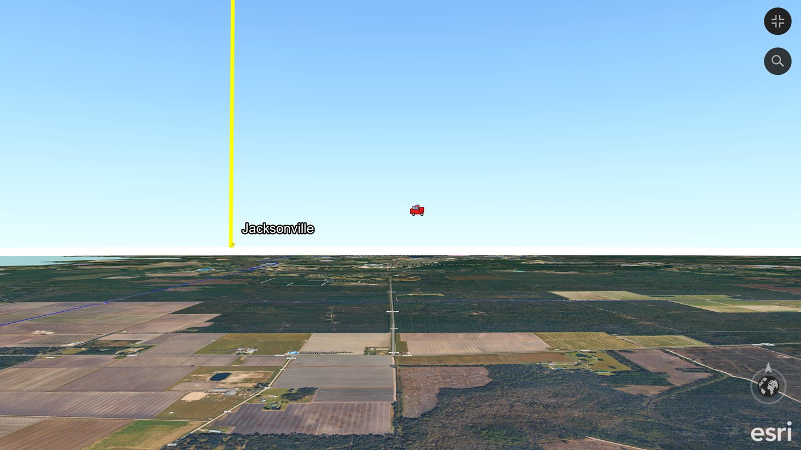

# ArcGIS Earth Object Factory

## Get everything you need

**1. ⬇️ [ArcGIS Earth](https://www.esri.com/en-us/arcgis/products/arcgis-earth/downloads)** - free 3D globe from Esri (Windows desktop version).

**2. ⬇️ [Python 3](https://www.python.org/downloads/windows/)** - free; install with the default options.

> **First time? Three quick tips**
> 1. **Extract the zip first:** right-click the downloaded zip > **Extract All**, then open the new folder. Double-clicking files while they are still inside the zip does not work.
> 2. **Windows security warning:** Windows may warn about any program downloaded from the internet. Click **More info > Run anyway** (blue "Windows protected your PC" screen) or **Run**. To avoid the warning, right-click the zip > **Properties** > tick **Unblock** > **OK** before extracting.
> 3. **Installing Python:** if the installer shows **"Add python.exe to PATH"**, tick it.

### **⬇️ [3. DOWNLOAD ARCGIS EARTH OBJECT FACTORY v1.2](releases/ArcGIS_Earth_Object_Factory_v1.2.zip)**
**📖 [User manual](docs/OBJECT_FACTORY_USER_MANUAL.md)**
**🗂️ [What's in the zip - every file explained](assets/object_factory_whats_in_the_zip_full.png)**

Create geographic objects, batches, sky compass markers, and beacons for ArcGIS Earth.

[](https://www.youtube.com/watch?v=5Wn14qlC7n4)

*Made with the Object Factory: a Jacksonville beacon on the horizon and an airborne fire-truck object, live in ArcGIS Earth. ▶️ [Watch the video](https://www.youtube.com/watch?v=5Wn14qlC7n4) (YouTube).*

## See what it makes - try it in 2 minutes - no Python needed

Install **[ArcGIS Earth](https://www.esri.com/en-us/arcgis/products/arcgis-earth/downloads)**, then download any of these and drag it onto the ArcGIS Earth map (or use the **+** Add data button). They are all near Jacksonville, Florida.

- 📡 **[Live traffic camera](https://github.com/Jim-dc95811/ArcGIS-Earth-Object-Factory/raw/main/samples/SAMPLE_Live_Traffic_Camera.kmz)** - click the floating camera: a live FL511 traffic camera opens and refreshes every 10 seconds.
- 🔴 **[Beacon](https://github.com/Jim-dc95811/ArcGIS-Earth-Object-Factory/raw/main/samples/SAMPLE_Beacon.kmz)** - a tall red beacon you can see and fly to from far away.
- 🧭 **[Sky Compass](https://github.com/Jim-dc95811/ArcGIS-Earth-Object-Factory/raw/main/samples/SAMPLE_Sky_Compass.kmz)** - giant N / E / S / W letters in the sky around the area.
- 🚁 **[Object set](https://github.com/Jim-dc95811/ArcGIS-Earth-Object-Factory/raw/main/samples/SAMPLE_Object_Set.kmz)** - floating fuel, helicopter, bird, camera and hazard objects; click them for their information.

Make your own with the Object Factory download above.

**Put objects into the real map.**

ArcGIS Earth Object Factory is a Windows/Python authoring tool for creating geographic objects that open directly in **ArcGIS Earth**. It grew from the original Earth Beacon experiment into a general factory for sky objects, ground objects, batch object sets, horizon navigation markers, and clickable information.

> **Choose an object -> choose where it lives -> choose what it shows -> create it.**

No ArcGIS Pro project, QGIS project, KML hand-editing, or GIS database design is required for normal object creation.

## Quick start

1. Download and extract [`ArcGIS_Earth_Object_Factory_v1.2.zip`](releases/ArcGIS_Earth_Object_Factory_v1.2.zip).
2. Double-click `Run_Object_Factory.bat`.
3. Use **Objects**, **Batch**, **Sky Compass**, or **Beacon**.
4. Open the generated KML/KMZ in ArcGIS Earth.

No third-party Python packages are required.

## Release details

**ArcGIS Earth Object Factory v1.2 - released 2026-11-02**

- **[Open the v1.2 Python source](source/Object_Factory_v1.2.py)**
- **[What changed in v1.2](docs/OBJECT_FACTORY_V1.2_CHANGES.md)**
- **[Open the v1.2 User Manual](docs/OBJECT_FACTORY_USER_MANUAL.md)** ([PDF](docs/ArcGIS_Earth_Object_Factory_v1.2_User_Manual.pdf))

Source SHA-256: `1310743e2f129d70dd85291efe1922c2f275bedbb9a91f45759d5925b4640ff9`  
ZIP SHA-256: `531d4e0e54e38a0608052ba4140c51534101e40a16d75af6842532701c2fe1c4`

v1.2 adds **Hide above (ft)**: objects show only while you are within about that distance (straight down, the eye alt ArcGIS Earth shows), so a city full of objects no longer clutters the view from high above, while flying low you still see them in the distance. The Objects tab now takes altitude in feet, and an empty Info popup shows the object's name. The previous release, v1.1, stays at `releases/ArcGIS_Earth_Object_Factory_v1.1.zip`.

v1.1 was a hardening release. From Clipboard now understands N/S/E/W letters and degrees-minutes-seconds and states exactly how it read the coordinate. The factory asks before replacing a file, keeps the previous file if a build fails, and names the line of any batch-list problem. Everything it creates is identical to v1.0. v1.0 (commissioned 2026-10-29) remains in the repository history.

## Four tools in one factory

### Objects
Create one geographic PNG object at a time.

- manual latitude/longitude or **From Clipboard**
- 11 built-in presets
- custom transparent PNG support
- automatic PNG inspection
- packaged working copy normalized to a maximum 256 px dimension
- source PNG never modified
- altitude in feet; `relativeToGround`, `absolute`, or `clampToGround`
- **Hide above (ft)**: disappears when you are far away, so many objects don't clutter the view (v1.2)
- adjustable icon scale
- optional vertical tether
- labels off by default
- multiline Info text
- Info popup or No Popup
- optional clickable hyperlink
- KMZ output

Built-in presets:

`object, helicopter, fuel, bird, hazard, home, staging, water, firetruck, camera, medical`

### Batch
Turn a simple text/CSV list into one object-set KMZ.

```text
fuel,30.410104,-81.922396
helicopter,30.398210,-81.931440,300
bird,30.402778,-81.918620,120,Mystery Bird
home,30.385525,-81.930807
```

Full format:

```text
type|name|lat|lon|alt_m|icon|description|url|link_text|scale|altitude_mode|tether|popup|label|hide_above_ft
```

`alt_m` is in metres; the `hide_above_ft` column (feet) is optional.

Duplicate source icons are normalized once and reused inside the KMZ.

### Sky Compass
Generate giant **N / E / S / W** horizon markers around a chosen center.

The Sky Compass was live-tested in ArcGIS Earth and gives EarthStick pilots a persistent visual orientation system in horizon view.

### Beacon
The original Earth Beacon geometry is integrated directly into the factory.

> **A pin marks a place. A beacon gives you something to aim at.**

Earth Beacon started this project; its beacon is now the Beacon tab.

## Fast coordinate workflow

1. In Google Maps, right-click the location and click the coordinate at the top of the menu (e.g. `30.40098, -81.93471`) to copy it.
2. Click **From Clipboard**.
3. Read the line under the button, e.g. `Read as Latitude 30.400980 N, Longitude 81.934710 W`, and check it is the place you meant.
4. Choose the object/preset.
5. Create the KMZ/KML.
6. Add it to ArcGIS Earth.

From Clipboard also understands N/S/E/W letters (`30.4009768°N 81.9347098°W`) and degrees-minutes-seconds. The factory intentionally does **not** take coordinates from the ArcGIS Earth camera; placement stays explicit.

## PNG rule

The operator's original PNG is never modified.

The factory uses Tkinter's native PNG support and creates a packaged working copy no larger than 256 px on its longest dimension while preserving aspect ratio and transparency. Smaller clean icons are not unnecessarily enlarged.

## Clickable information and links

Most objects are intended to remain visually clean with **no permanent label**.

> **See it -> recognize it -> click it -> understand it.**

Info objects can contain multiline text and an optional standard HTML hyperlink. That supports an offline-first model while still allowing connected extensions such as live webcams, Street View, agency pages, training resources, or other web content.

ArcGIS Earth's native KML information panel is relatively large; that panel size is viewer behavior, not PNG size or Object Factory geometry.

## Live-proven development path

The risky pieces were proved separately before integration:

- **POF1:** arbitrary airborne PNG object - live-proven in ArcGIS Earth
- **POF2:** batch object list -> multi-object KMZ - live-proven
- **POF3:** generated NSEW Sky Compass - live-proven
- **Earth Beacon:** long-range vertical KML navigation marker - live-proven

v1.0 integrated those primitives into one factory; v1.1 hardened it; v1.2 added Hide above.

## Developer self-test

```text
py -3 Object_Factory_v1.2.py --selftest
```

The self-test covers PNG normalization/original preservation, single-object KMZ, hyperlink output, no-popup KML style, a 100-object batch pack, duplicate icon reuse, shorthand parsing, Sky Compass generation, Beacon generation, (v1.1) the clipboard reader, batch header detection, line-numbered errors and safe output, and (v1.2) Hide above and name popups.

Run it from inside the extracted `Object_Factory_v1.2` folder (in File Explorer, type `cmd` in the address bar and press Enter).

## Relationship to EarthStick

[EarthStick](https://github.com/Jim-dc95811/EarthStick) provides direct joystick navigation through ArcGIS Earth.

> **EarthStick = movement**  
> **Sky Compass = orientation**  
> **Earth Beacon = destination**  
> **Object Factory = objects and meaning**

## ArcGIS Earth Unlocked ecosystem

Object Factory is the active object-authoring and experimentation center in the broader **[ArcGIS Earth Unlocked](https://github.com/Jim-dc95811/ArcGIS-Earth-Unlocked)** project family.

- **Foundation maps:** [QGIS MBTiles -> ArcGIS Earth TPKX](https://github.com/Jim-dc95811/QGIS-Mbtile-to-ArcGIS-Earth-TPKX)
- **Offline field-map workflows:** [ArcGIS Earth Offline Maps & Chartplotting](https://github.com/Jim-dc95811/ArcGIS-Earth-Offline-Maps-Chartplotting)
- **Navigation:** [EarthStick](https://github.com/Jim-dc95811/EarthStick)
- **Operational point layers:** [Point Maps / PointLayer](https://github.com/Jim-dc95811/Point-Maps)
- **Parcel intelligence:** [Parcel100](https://github.com/Jim-dc95811/Parcel100)
- **Objects / navigation markers / experiments:** this repository

## Earth Beacon legacy

This repository began as **Earth Beacon**. Earth Beacon started this project; its beacon is now the Beacon tab, which makes the same beacon.

The original standalone Beacon Maker v1.0 is preserved rather than discarded: its source and documentation are kept under [`legacy/Earth_Beacon_v1.0/`](legacy/Earth_Beacon_v1.0/). It is no longer offered as a separate download (retired 2026-10-31); its last package remains in the repository history.

The Beacon concept did not disappear; it became one of the four main Object Factory tools.

## Documentation / project brain

- [v1.2 User Manual](docs/OBJECT_FACTORY_USER_MANUAL.md) ([PDF](docs/ArcGIS_Earth_Object_Factory_v1.2_User_Manual.pdf))
- [Quick operator guide](docs/OBJECT_FACTORY_GUIDE.md)
- [v1.2 change document](docs/OBJECT_FACTORY_V1.2_CHANGES.md)
- [v1.1 change document](docs/OBJECT_FACTORY_V1.1_CHANGES.md)
- [CONTINUITY.md](internal/CONTINUITY.md) - project handoff and verified/conceptual status
- [MAPWORLD.md](internal/MAPWORLD.md) - technical ArcGIS Earth format/object inventory; "Mapworld" remains an internal working term
- [CHANGELOG.md](CHANGELOG.md)
- [ArcGIS Earth Unlocked master umbrella](https://github.com/Jim-dc95811/ArcGIS-Earth-Unlocked)

## Requirements

- Windows
- Python 3 with Tkinter
- ArcGIS Earth desktop for use/testing of generated files

Object Factory v1.2 uses the Python standard library and Tkinter. No Pillow installation is required.

## Human-AI engineering collaboration

Object Factory was conceived, directed, and live-tested by **Jim Gaddy**, working with **OpenAI's ChatGPT** and **Anthropic's Claude** as AI coding and documentation partners. Jim supplied the operational concepts, ArcGIS Earth acceptance tests, UX decisions, and field feedback; ChatGPT assisted with the original implementation (v1.0), regression testing, packaging, and documentation; Claude built v1.1 (hardening) and v1.2 (Hide above, calibrated from Jim's live screenshots), the try-it samples, the user manual and the 'What's in the zip' sheet.

This acknowledgment is not a claim of OpenAI or Anthropic sponsorship or endorsement.

## Independence and data responsibility

Independent project; not affiliated with or endorsed by Esri. ArcGIS and ArcGIS Earth are Esri products and trademarks.

Users remain responsible for the rights, accuracy, currency, and suitability of imagery, icons, URLs, agency data, public services, and other third-party content they place into their own object packs.

## License

MIT License. See [`LICENSE`](LICENSE).
